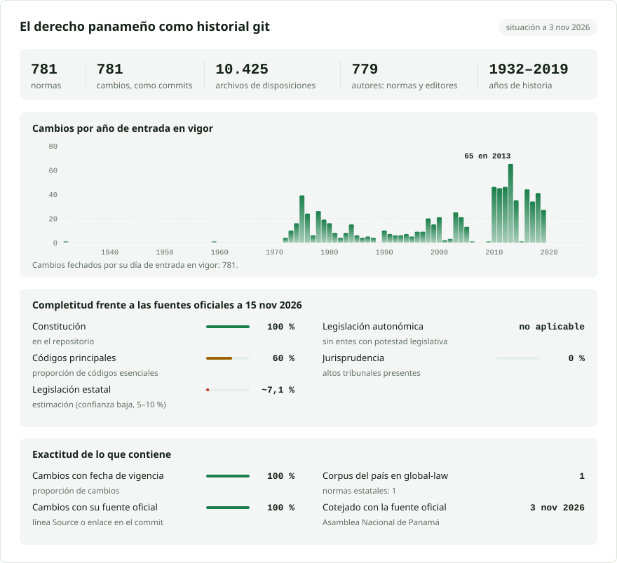

# Panamá: historia del derecho en git

**Español** · [English](README.en.md)

<picture>
<source media="(prefers-color-scheme: dark)" srcset="data/es/effort-dark.svg">

</picture>

El derecho de Panamá como historial de git: un archivo por artículo, un commit por versión, fechado el día de su entrada en vigencia, y la norma que hizo cada cambio como autora del commit. `git blame` nombra la norma de cada artículo; `git log` enumera cada cambio de un artículo; al elegir una fecha se obtiene el texto vigente ese día.

Forma parte de [lexifina/global-law](https://github.com/lexifina/global-law), un único historial de git para el derecho de todos los países: este es el derecho nacional de Panamá, que global-law lee en `panama/national/acts/`.

**Qué contiene ahora:** la Constitución, tres códigos (el Código Penal, el Código Procesal Penal y el Código del Trabajo) y 777 leyes de la Asamblea Nacional promulgadas de 1932 a 2019, cada norma en una versión. Las leyes son aquellas cuyo registro en Legispan no enumera ninguna norma que las modifique, derogue, suspenda o reglamente, de modo que el texto tal como se expidió es también el texto vigente. [`data/versions.json`](data/versions.json) enumera cada norma con sus versiones; [`data/paths.json`](data/paths.json) relaciona el id de cada norma con su carpeta.

Cada norma es una carpeta `<kind>/<year>/<number>/` con un archivo por artículo y un `README.md` que los enumera (`ley/2010/0045/` es la Ley 45 de 2010, con el texto anterior al Artículo 1 en `encabezado.md` y la fórmula de cierre en `firma.md`); la Constitución es [`constitution/constitucion/`](constitution/constitucion/) y los códigos están en `code/` (`code/codigo-del-trabajo/` es el Código del Trabajo, Decreto de Gabinete 252 de 1971). Las carpetas recibieron estos nombres el 10 de noviembre de 2026 (commit `51cde9a`, sin cambio de derecho): `git log` necesita `--follow` para alcanzar el nombre anterior de un archivo, y `tools/on.py` lee ambos.

El texto está en español, tal como lo imprimen las fuentes. Una traducción al inglés no forma parte de este registro.

## Preguntas como comandos de git

| Pregunta | Comando |
| --- | --- |
| Cada cambio del artículo 54 del Código del Trabajo (vacaciones) | `git log -p --follow --word-diff -- code/codigo-del-trabajo/art-054.md` |
| ¿Qué norma escribió cada línea del artículo 54? | `git blame code/codigo-del-trabajo/art-054.md` |
| Cada versión del Código del Trabajo, con el día en que entró en vigencia cada una | `git log --no-walk --tags="codigo-del-trabajo/*" --format="%h %(trailers:key=In-force,valueonly,separator=) %an"` |
| El artículo 54 vigente el 1 de enero de 2015 | `python tools/on.py 2015-01-01 codigo-del-trabajo art-054` |

**Fuera de git**, también alojamos este registro de forma pública y gratuita:

- **[Pregunte a Claude sobre el derecho panameño](https://global-law.lexifina.com/v1/try_claude?country=panama)**: abre Claude con una primera pregunta ya preparada.
- **[Pregunte a ChatGPT](https://global-law.lexifina.com/v1/try_chatgpt?country=panama)**: la misma pregunta en ChatGPT.
- **[Busque en el derecho panameño en nuestro sitio](https://lexifina.com/law?country=panama&q=vacaciones)**: una búsqueda de "vacaciones", con el texto de cada disposición y sus versiones, sin necesidad de cuenta.
- **[API REST para desarrolladores](https://global-law.lexifina.com/v1/search_law?query=vacaciones&jurisdiction=panama)**: la misma búsqueda en JSON, sin clave. Consulte la [documentación aquí](https://lexifina.com/api/global-law).

Ambos asistentes leen el registro mediante el conector gratuito Global law (MCP, `https://global-law.lexifina.com/mcp`); la primera vez, el chat le da el enlace para añadirlo. Pregunte en español o en inglés.

**Alójelo usted mismo fácilmente.** Solo hacen falta git y Python, y las herramientas se ejecutan en su propio equipo:

```sh
git clone --depth 1 https://github.com/lexifina/global-law && cd global-law
python3 tools/countries.py add panama/national/acts
python3 tools/law.py show 2026-01-01 panama/national/acts/code/codigo-del-trabajo/art-054.md
```

Abierto en Claude Code, Cursor, VS Code o Codex, el clon también inicia un servidor MCP local con las mismas herramientas ([MCP.md](https://github.com/lexifina/global-law/blob/main/MCP.md)).

## Fechas

Cada commit está fechado al mediodía, hora de America/Panama, del día en que la versión entró en vigencia, y lo lleva en su trailer `In-force:`:

- para las 777 leyes, el día de su promulgación en la Gaceta Oficial, tal como lo da su registro en Legispan; no se muestra un día posterior que una ley fije para su propia entrada en vigencia;
- para el Código Procesal Penal (Ley 63 de 2008), el 2 de septiembre de 2009, el día que indica su art. 560;
- para la Constitución, el 15 de noviembre de 2004, el día de la Gaceta Oficial (No. 25176) que publicó su Texto Único; para el Código Penal y el Código del Trabajo, la fecha de creación de sus PDF de origen (11 de diciembre de 2019 y 26 de junio de 2003), ya que las fuentes no dan ninguna fecha para la edición;
- git no puede almacenar fechas anteriores a 1970, por lo que los 2 commits anteriores (Ley 46 de 1932 y Ley 18 de 1959) llevan la fecha 1970-01-01, con el día real en `In-force:`. Para consultar una fecha use `tools/on.py`, no `git log --before`.

Cada ley se atribuye a sí misma (`Ley 45 de 2010`), y el Código Procesal Penal a `Ley 63 de 2008`. La Constitución, el Código Penal y el Código del Trabajo son cada uno la versión más antigua disponible como texto, atribuida al editor como `Asamblea Nacional de Panamá` (`Kind: publisher`).

## Cómo se comprueba

- Cada palabra de la edición transcrita de una ley de la Asamblea Nacional está en un archivo, en orden, salvo el encabezado de página y los números de página; se deja fuera una ley cuyos propios artículos no estén numerados 1, 2, 3 y así sucesivamente, cada número una sola vez.
- Solo se leen capas de texto: no se leen las páginas escaneadas de la Gaceta ni se usa OCR; se deja fuera una ley sin edición transcrita, o con solo una capa de OCR.
- `tools/check_repo.py` vuelve a leer desde git cada versión en su día y la compara con el corpus, y el mismo corpus da los mismos hashes de commit; [`REPRODUCE.md`](REPRODUCE.md) da los hashes del corpus y del constructor, pero todavía no registra ninguna ejecución de la comprobación ni una segunda construcción.
- El historial solo crece por adición: no hay commits de fusión (merge), y los cambios posteriores (como el traslado de carpetas) son commits nuevos encima.

## Lo que no muestra

- **Las leyes que Legispan registra como modificadas, derogadas, suspendidas o reglamentadas**: quedan fuera hasta que se pueda mostrar su texto vigente, igual que las leyes cuyo PDF no tiene edición transcrita, como las leyes recientes publicadas solo como escaneos de la Gaceta; todavía no hay aquí ninguna posterior a 2019.
- **Los cambios de una norma a lo largo del tiempo.** Cada norma es una sola versión: el texto de 1972 de la Constitución y sus reformas (1978, 1983, 1993, 1994) no están aquí; no se aplican las reformas posteriores a la edición de 2003 del Código del Trabajo; y el Código Procesal Penal es el texto tal como se expidió, sin las leyes posteriores que lo modificaron y que aplazaron y escalonaron su entrada en vigencia.
- **El Código Civil y el Código de Comercio**: no se encontró ninguna copia oficial con una capa de texto utilizable.
- **Los decretos ejecutivos y demás reglamentos, los acuerdos municipales y la jurisprudencia.**

## Fuentes

| Fuente | Tipo | Versiones anteriores | Notas |
| --- | --- | --- | --- |
| [Asamblea Nacional de Panamá](https://asamblea.gob.pa) | Constitución, Texto Único (edición de abril de 2024) | no | PDF nativo digital, obtenido el 29 de octubre de 2026 |
| [Legispan](https://legispan.asamblea.gob.pa/) (Asamblea Nacional) | Leyes: las páginas de la Gaceta Oficial y la edición transcrita de la Asamblea | no, cada ley tal como se expidió | Obtenido el 3 de noviembre de 2026; solo se lee la edición transcrita |
| [Procuraduría General de la Nación](https://ministeriopublico.gob.pa) | Código Penal, Texto Único con la Ley 70 de 2019 | no | PDF nativo digital, obtenido el 30 de octubre de 2026 |
| Órgano Judicial (organojudicial.gob.pa) | Código Procesal Penal (el texto de la Gaceta Oficial 26114), Código del Trabajo (edición del Ministerio de Trabajo / OIT) | no | Leídos de copias del Internet Archive el 30 de octubre de 2026; no se reproducen las notas del editor del Código del Trabajo sobre las reformas |

## Licencia

Véase [`LICENSE`](LICENSE). Ninguna de las fuentes indica una licencia; los textos se reproducen sin cambios en su redacción, como derecho de Panamá, y la Asamblea Nacional no respalda este repositorio. Las aportaciones propias de Lexifina (la ordenación del historial, los mensajes de commit y las herramientas) son CC0 1.0.

Ningún modelo de IA escribió, tradujo ni corrigió texto jurídico, y ninguno se ejecuta al construir el historial; los scripts que leen las fuentes y construyen este repositorio los escribió Claude Code con Claude Opus 5.5 (véase [`REPRODUCE.md`](REPRODUCE.md)).

Esta es una traducción de la versión inglesa ([README.en.md](README.en.md)); si difieren, prevalece la versión inglesa.

## Más información

Del repositorio [lexifina/global-law](https://github.com/lexifina/global-law) (páginas en inglés):

- [FEATURES.md](https://github.com/lexifina/global-law/blob/main/FEATURES.md): todas las funciones y lo que cada corpus debe admitir (`git blame`, `law.py`, herramientas MCP)
- [FAQ.md](https://github.com/lexifina/global-law/blob/main/FAQ.md): preguntas y respuestas · [CONTRIBUTING.md](https://github.com/lexifina/global-law/blob/main/CONTRIBUTING.md): proponer cambios · [MCP.md](https://github.com/lexifina/global-law/blob/main/MCP.md): servidor MCP · [REPRODUCE.md](https://github.com/lexifina/global-law/blob/main/REPRODUCE.md): cómo se ha construido · [CHANGELOG.md](https://github.com/lexifina/global-law/blob/main/CHANGELOG.md)
- [FRESHNESS.md](https://github.com/lexifina/global-law/blob/main/FRESHNESS.md): lo actualizado que está cada corpus · [Supervisión](https://github.com/lexifina/global-law/tree/main/monitoring): si las actualizaciones funcionan · [WATCHING.md](https://github.com/lexifina/global-law/blob/main/WATCHING.md): cómo se vigila cada fuente oficial para detectar cambios
- [performance/](https://github.com/lexifina/global-law/tree/main/performance): la rapidez de las herramientas, medida
- [visualisations/](https://github.com/lexifina/global-law/tree/main/visualisations): gráficos y conexiones a través del derecho de todo el mundo
- [Vulnerabilidades](https://github.com/lexifina/global-law/tree/main/vulnerabilities): errores en las normas tal como se publicaron
