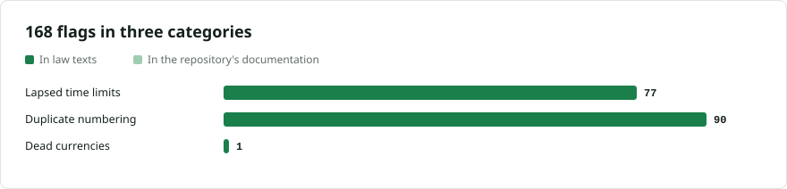

# Vulnerabilities in Panamanian law

[Español](README.md) · **English**

<picture>
<source media="(prefers-color-scheme: dark)" srcset="img/flags-by-category-dark.svg">

</picture>

The vulnerability detectors from [lexifina/global-law](https://github.com/lexifina/global-law/tree/main/vulnerabilities) look for mechanical mistakes in legislation: a rule applying "until" a date that has passed, a time limit extended only after it had run out, a provision repealed before its replacement took effect, an amount changed in one place but not in another, a reference to an article that no longer exists. global-law's published list (9 November 2026) did not include Panama, so this is a run over this repository only, as it stood at commit [`afee8ac`](https://github.com/lexifina/panama-law/commit/afee8acf5738545cd8eccb2685690fe366219dcc) on 16 November 2026: the Constitution, the Criminal Code, the Code of Criminal Procedure, the Labour Code and 777 laws promulgated from 1932 to 2019, each act in a single version.

**In short:** the detectors raised 168 flags. A language model reviewed the 40 strongest, arguing each one for and against; 4 survived. Checked by hand in this repository, none turned out to be a mistake in Panamanian law: 3 are spent rules that ran their course (a moratorium on property tax arrears that ended on 31 December 1999, a 2013 transitional paragraph on the tax on insurance premiums, and the 2010 and 2011 step of what casinos and slot-machine halls pay the Gaming Control Board), and 1 is lawful (the 1988 amnesty for political offences committed between 1 June and 24 December 1987). The model does not review two categories; reading them turned up no further mistake. The run did find two problems in this repository, described below. Later, this will be formalised in Lean, similar to our work on [the US tax code](https://lexifina.com/blog/formalizing-the-us-tax-code) and [US case law](https://lexifina.com/blog/formalizing-all-us-case-law-in-lean).

A flag is a prompt to look, not legal advice, and nothing here has been tested in court.

## Flags by category

| Category | What it looks for | Flags | In law texts | Reviewed | Survived review |
| --- | --- | ---: | ---: | ---: | ---: |
| Lapsed time limits | Text still applying a rule "until" a date that has passed | 77 | 77 | 40 | 4 |
| Duplicate numbering | Two units with the same number in one act | 90 | 90 | 0 | 0 |
| Dead currencies | Amounts in currencies no longer in use | 1 | 1 | 0 | 0 |

"In law texts" counts every file in the folders of acts: the Constitution, the codes and the laws (`constitution/`, `code/` and `ley/`); all 168 flags are in them. Each act is here a single version, so the detectors that compare versions (repeal gaps, same-day conflicts, empty periods, stale amounts) have no changes to compare and found nothing. As no article has been repealed or removed, there are no references to deleted or repealed provisions either, and no retroactive dates, since each law is dated the day it was promulgated in the Gaceta Oficial. The search for dead fines found nothing, and neither did the search for publisher notes: the texts carry no "(sic)". The balboa and the US dollar, both legal tender in Panama, do not count as dead currencies. The search for lapsed time limits reads the dates of Panamanian laws ("hasta el 31 de diciembre de 2011", "hasta el día 31 de mayo de 1982", "hasta el treinta (30) de junio de 1982", "hasta el 31 de octubre de 1975") and the deadlines "a más tardar el 31 de Octubre de 1979" (no later than) and "dentro de un término que vence el 30 de junio de 1978" (within a period ending on); it still leaves out dates that give only a year, such as "ejercerá sus funciones hasta el año 2005" (shall serve until the year 2005; Law 6 of 2000, Article 8) or "hasta 2014" and "hasta 2016" in the Ballast Water Management Convention (Law 41 of 2016). In this repository, the duplicate-numbering search read a line that opens with a reference ("Artículo 2 de este Acuerdo", "Artículo 14, apartado 2") as a second heading, and the dead-currency search took the name of the peasant settlement "Victoriano Franco" for francs; both were fixed (see [tools/](tools/)), and the flags went from 108 to 90 and from 2 to 1.

*Edge cases: the 4 flags that survived the review, grouped by what they turned out to be, and what the other flags are, in [EDGE-CASES.en.md](EDGE-CASES.en.md).*

## Problems found in this repository

- **Page headers and footers inside the text of articles:** the repository's README says the page header and page numbers of the typed edition are left out, but 337 lines that hold only the number of the Gaceta Oficial ("G.O. 27,027-A") remain in 168 article files of 60 laws, and 99 lines "ASAMBLEA NACIONAL, REPÚBLICA DE PANAMÁ" in 16 article files of 9 laws. Some cut a sentence in two: in [Law 83 of 2017](https://github.com/lexifina/panama-law/blob/afee8acf5738545cd8eccb2685690fe366219dcc/ley/2017/0083/art-001.md) (amendments to the Air Services Agreement with Korea), paragraph 3 of Article 10 of Appendix 1 breaks off at "Si las Partes Contratantes llegan a un acuerdo respecto a las" (if the Contracting Parties reach agreement on the), and after the line "ASAMBLEA NACIONAL, REPÚBLICA DE PANAMÁ" goes on "tarifas por las cuales la nota de insatisfacción fue enviada" (tariffs for which the note of dissatisfaction was sent). Other Gazette numbers were left at the end of a line of text ("...de 20 de mayo de 1985. G.O. 27,377-B", Article 3 of Law 63 of 2013) and are not counted.
- **An article of a law inside the previous article's file:** in five laws approving treaties (Laws [11 of 1999](https://github.com/lexifina/panama-law/blob/afee8acf5738545cd8eccb2685690fe366219dcc/ley/1999/0011/art-001.md), 4 of 2003, 75 of 2003, 37 of 2004 and 38 of 2004), the law's Article 2, which sets when it takes effect, is at the end of `art-001.md`, after the treaty's text, and the act's index (its `README.md`) lists only Article 1; in [Law 27 of 1973](https://github.com/lexifina/panama-law/blob/afee8acf5738545cd8eccb2685690fe366219dcc/ley/1973/0027/art-003.md), Article 4 is in Article 3's file. A reader looking for the file of those articles does not find it. They were found by searching for commencement clauses; whether other articles are in the same case has not been checked.

## Files

| File | What it holds |
| --- | --- |
| [data/flags.csv](data/flags.csv) | Every flag, one row per provision and issue |
| [data/reviewed.csv](data/reviewed.csv) | The 40 flags the model reviewed, with its verdict and reason |
| [data/by_category.csv](data/by_category.csv) | The counts in the table above |
| [tools/](tools/) | The scripts that made this run |

Columns: `category` and `category_es` (the category in English and Spanish), `detector`, `kind` (`law` or `other`), `path` (the file in this repository), `date` (the date the flag turns on), `reference` (the act or line involved), `summary`, `score` (the detector's ranking, 0 to 1), `review` (`artefact`, `lawful` or `candidate_defect`), `survives_rebuttal`, `review_note` (the model's reason, in English), `url` (the provision at the commit that was read).

## How it was made

- **Detectors:** global-law's [vulnerabilities/scripts](https://github.com/lexifina/global-law/tree/main/vulnerabilities/scripts), run on this repository at commit `afee8ac`. global-law replays this repository only up to an earlier commit, so the history table the detectors read was built from this repository's own commits (the act that made each change, its `In-force` date and its `Kind`; laws and oldest available versions count as law, documentation is left out), with the paths from before the folder move of 10 November 2026 mapped to each act's folder today. The detectors carry the fixes global-law's scripts received in the runs on other country repositories, among them the date forms of the Spanish of Spain, Colombia, Mexico and El Salvador ("hasta el día 31 de diciembre de 2020", "1o. de enero", "a más tardar el ..."), and two for Panama: the duplicate-numbering and franc fixes above.
- **Model review:** gpt-5.4-mini, the 40 strongest flags per category; one pass says whether a flag is real, a second argues that it is not. The model does not review duplicate numbering or dead currencies. global-law's own list used a different model.
- **Hand check:** every flag that survived was read in this repository's texts, with the same law's commencement clause and the day it was promulgated. All the duplicate-numbering and dead-currency flags and the 77 lapsed time limits were also read. The page headers and footers and the articles outside their file were counted with `page_lines.py` (in [tools/](tools/)).

To report a correction, open an issue with the provision and an official source.

## Licence

The lists and notes are Lexifina's, dedicated to the public domain under CC0 1.0, like the rest of this repository's own contributions. Quoted law text is that of the laws as Legispan, the Asamblea Nacional's system, publishes them, which states no licence; it is reproduced without change to its wording, as the law of Panama. The Asamblea Nacional does not endorse this repository. See [LICENSE](../LICENSE).
