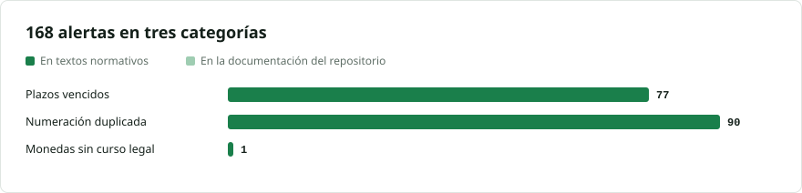

# Vulnerabilidades en el derecho panameño

**Español** · [English](README.en.md)

<picture>
<source media="(prefers-color-scheme: dark)" srcset="img/flags-by-category-dark.es.svg">

</picture>

Los detectores de vulnerabilidades de [lexifina/global-law](https://github.com/lexifina/global-law/tree/main/vulnerabilities) buscan errores mecánicos en la legislación: una regla que sigue aplicándose «hasta» una fecha ya pasada, un plazo prorrogado cuando ya había vencido, una disposición derogada antes de que rigiera la que la sustituye, un monto modificado en un lugar pero no en otro, una remisión a un artículo que ya no existe. La lista que global-law publicó el 9 de noviembre de 2026 no incluía Panamá, de modo que esta es una revisión de este repositorio solamente, en el estado del commit [`afee8ac`](https://github.com/lexifina/panama-law/commit/afee8acf5738545cd8eccb2685690fe366219dcc) de 16 de noviembre de 2026: la Constitución, el Código Penal, el Código Procesal Penal, el Código del Trabajo y 777 leyes promulgadas de 1932 a 2019, cada norma en una sola versión.

**En resumen:** los detectores generaron 168 alertas. Un modelo de lenguaje revisó las 40 más sólidas, con argumentos a favor y en contra de cada una; 4 resistieron. Comprobadas a mano en este repositorio, ninguna resultó ser un error del derecho panameño: 3 son reglas agotadas, que se cumplieron en su fecha (una moratoria del impuesto de inmueble que venció el 31 de diciembre de 1999, un parágrafo transitorio de 2013 sobre el impuesto de primas de seguros y el primer tramo, de 2010 y 2011, de lo que los casinos y las salas de máquinas tragamonedas pagan a la Junta de Control de Juegos), y 1 es conforme a derecho (la amnistía de 1988 para los delitos políticos cometidos entre el 1 de junio y el 24 de diciembre de 1987). El modelo no revisa dos categorías; su lectura no arrojó ningún error más. La revisión sí halló dos problemas de este repositorio, que se describen más abajo. Más adelante se formalizará en Lean, como nuestro trabajo sobre [el código tributario de EE. UU.](https://lexifina.com/blog/formalizing-the-us-tax-code) y [la jurisprudencia de EE. UU.](https://lexifina.com/blog/formalizing-all-us-case-law-in-lean).

Una alerta es una invitación a examinar el texto, no un asesoramiento jurídico, y nada de lo aquí expuesto se ha sometido a un juez.

## Alertas por categoría

| Categoría | Qué busca | Alertas | En textos normativos | Revisadas | Resistieron la revisión |
| --- | --- | ---: | ---: | ---: | ---: |
| Plazos vencidos | Un texto que sigue aplicando una regla «hasta» una fecha ya pasada | 77 | 77 | 40 | 4 |
| Numeración duplicada | Dos divisiones con el mismo número en una norma | 90 | 90 | 0 | 0 |
| Monedas sin curso legal | Montos en monedas que ya no se usan | 1 | 1 | 0 | 0 |

«En textos normativos» cuenta todos los archivos de las carpetas de normas: la Constitución, los códigos y las leyes (`constitution/`, `code/` y `ley/`); las 168 alertas están en ellas. Cada norma es aquí una sola versión, de modo que los detectores que comparan versiones (vacíos tras la derogación, reformas del mismo día, periodos de vacío normativo, montos no actualizados) no tienen cambios que comparar y no hallaron nada. Como ningún artículo se ha derogado ni suprimido, tampoco hay remisiones a disposiciones inexistentes o derogadas, y no hay vigencias anteriores a la promulgación porque cada ley está fechada el día de su promulgación en la Gaceta Oficial. La búsqueda de sanciones sin conducta tipificada no halló nada, y la de notas del editor tampoco: los textos no llevan ningún «(sic)». El balboa y el dólar de los Estados Unidos, las dos monedas de curso legal en Panamá, no cuentan como monedas sin curso legal. La búsqueda de plazos vencidos lee las fechas de las leyes panameñas («hasta el 31 de diciembre de 2011», «hasta el día 31 de mayo de 1982», «hasta el treinta (30) de junio de 1982», «hasta el 31 de octubre de 1975») y los plazos «a más tardar el 31 de Octubre de 1979» o «dentro de un término que vence el 30 de junio de 1978»; sigue sin leer las que solo indican un año, como «ejercerá sus funciones hasta el año 2005» (Ley 6 de 2000, artículo 8) o «hasta 2014» y «hasta 2016» en el Convenio sobre la gestión del agua de lastre (Ley 41 de 2016). En este repositorio, la búsqueda de numeración duplicada leía como un segundo encabezado la línea que empieza con una remisión («Artículo 2 de este Acuerdo», «Artículo 14, apartado 2»), y la de monedas sin curso legal tomaba por francos el nombre del asentamiento campesino «Victoriano Franco»; ambas se corrigieron (véase [tools/](tools/)), y las alertas pasaron de 108 a 90 y de 2 a 1.

*Casos límite: las 4 alertas que resistieron la revisión, agrupadas según lo que resultaron ser, y qué son las demás alertas, en [EDGE-CASES.md](EDGE-CASES.md).*

## Problemas detectados en este repositorio

- **Encabezados y pies de página dentro del texto de los artículos:** el README del repositorio dice que se dejan fuera el encabezado de página y los números de página de la edición transcrita, pero 337 líneas que solo contienen el número de la Gaceta Oficial («G.O. 27,027-A») siguen en 168 archivos de artículos de 60 leyes, y 99 líneas «ASAMBLEA NACIONAL, REPÚBLICA DE PANAMÁ» en 16 archivos de artículos de 9 leyes. A veces cortan una frase: en la [Ley 83 de 2017](https://github.com/lexifina/panama-law/blob/afee8acf5738545cd8eccb2685690fe366219dcc/ley/2017/0083/art-001.md) (enmiendas al Convenio de Servicios Aéreos con Corea), el párrafo 3 del artículo 10 del Apéndice 1 se interrumpe en «Si las Partes Contratantes llegan a un acuerdo respecto a las», y tras la línea «ASAMBLEA NACIONAL, REPÚBLICA DE PANAMÁ» sigue «tarifas por las cuales la nota de insatisfacción fue enviada». Otros números de la Gaceta quedaron al final de una línea de texto («...de 20 de mayo de 1985. G.O. 27,377-B», artículo 3 de la Ley 63 de 2013) y no están contados.
- **Un artículo de la ley dentro del archivo del artículo anterior:** en cinco leyes aprobatorias de tratados (las Leyes [11 de 1999](https://github.com/lexifina/panama-law/blob/afee8acf5738545cd8eccb2685690fe366219dcc/ley/1999/0011/art-001.md), 4 de 2003, 75 de 2003, 37 de 2004 y 38 de 2004), el artículo 2 de la ley, el que fija su entrada en vigencia, está al final de `art-001.md`, tras el texto del tratado, y el índice de la norma (su `README.md`) enumera solo el artículo 1; en la [Ley 27 de 1973](https://github.com/lexifina/panama-law/blob/afee8acf5738545cd8eccb2685690fe366219dcc/ley/1973/0027/art-003.md), el artículo 4 está en el archivo del artículo 3. Quien busque el archivo de esos artículos no lo encuentra. Se hallaron buscando las cláusulas de entrada en vigencia; no se comprobó si otros artículos están en el mismo caso.

## Archivos

| Archivo | Contenido |
| --- | --- |
| [data/flags.csv](data/flags.csv) | Todas las alertas, una fila por disposición y problema |
| [data/reviewed.csv](data/reviewed.csv) | Las 40 alertas que revisó el modelo, con su veredicto y su motivo |
| [data/by_category.csv](data/by_category.csv) | Las cifras de la tabla anterior |
| [tools/](tools/) | Los scripts de esta revisión |

Columnas: `category` y `category_es` (la categoría en inglés y en español), `detector`, `kind` (`law` u `other`), `path` (el archivo en este repositorio), `date` (la fecha de la que depende la alerta), `reference` (la norma o la línea afectada), `summary`, `score` (la puntuación del detector, de 0 a 1), `review` (`artefact`, `lawful` o `candidate_defect`), `survives_rebuttal`, `review_note` (el motivo del modelo, en inglés), `url` (la disposición en el commit leído).

## Cómo se hizo

- **Detectores:** los [vulnerabilities/scripts](https://github.com/lexifina/global-law/tree/main/vulnerabilities/scripts) de global-law, ejecutados sobre este repositorio en el commit `afee8ac`. global-law reproduce este repositorio solo hasta un commit anterior, por lo que la tabla histórica que leen los detectores se construyó con los propios commits de este repositorio (la norma que hizo cada cambio, su fecha `In-force` y su `Kind`; las leyes y las versiones más antiguas disponibles cuentan como derecho, y se excluye la documentación), con las rutas anteriores al traslado de carpetas de 10 de noviembre de 2026 llevadas a la carpeta actual de cada norma. Los detectores incorporan las correcciones que los scripts de global-law recibieron en las revisiones de otros repositorios nacionales, entre ellas las formas de fecha del español de España, Colombia, México y El Salvador («hasta el día 31 de diciembre de 2020», «1o. de enero», «a más tardar el ...»), y dos para Panamá: las de la numeración duplicada y de los francos indicadas arriba.
- **Revisión por el modelo:** gpt-5.4-mini, las 40 alertas más sólidas de cada categoría; una pasada dice si la alerta es real y otra argumenta que no lo es. El modelo no revisa la numeración duplicada ni las monedas sin curso legal. La lista propia de global-law usó otro modelo.
- **Comprobación manual:** cada alerta que resistió se leyó en los textos de este repositorio, con la cláusula de entrada en vigencia de la misma ley y su fecha de promulgación. Se leyeron también todas las alertas de numeración duplicada y de monedas sin curso legal y las 77 de plazos vencidos. Los encabezados y pies de página y los artículos fuera de su archivo se contaron con `page_lines.py` (en [tools/](tools/)).

Para comunicar una corrección, abra una incidencia con la disposición y una fuente oficial.

## Licencia

Las listas y las notas son de Lexifina y se dedican al dominio público con CC0 1.0, como las demás aportaciones propias de este repositorio. El texto jurídico citado es el de las leyes tal como las publica Legispan, el sistema de la Asamblea Nacional, que no indica ninguna licencia; se reproduce sin cambios en su redacción, como derecho de Panamá. La Asamblea Nacional no avala este repositorio. Véase [LICENSE](../LICENSE).
